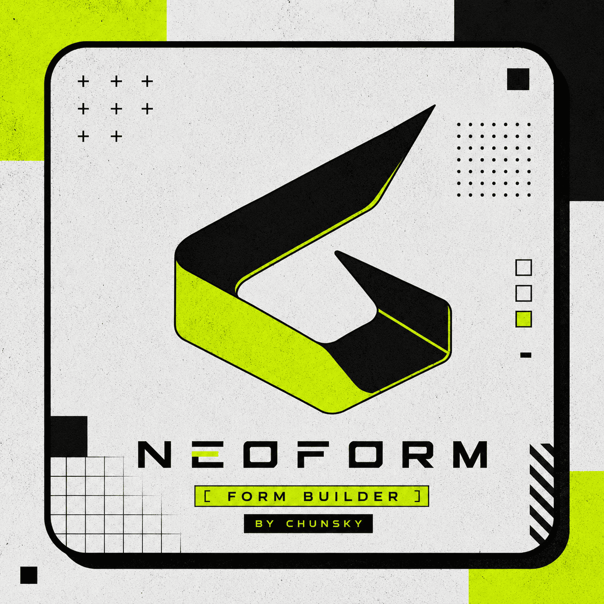

# NEOFORM

**Neoform** adalah aplikasi web untuk membuat formulir, membagikannya melalui tautan atau QR code, lalu mengelola jawaban dalam satu dashboard.

- **Demo web:** [neoform.chunsky.biz.id](https://neoform.chunsky.biz.id)
- **Aplikasi Android:** [Unduh APK](public/neoform.apk)
- **Pengembang:** Chunsky X ANTISUKI

## Tentang proyek

Neoform menyederhanakan alur pengumpulan data: pembuat formulir menyusun pertanyaan sesuai kebutuhan, membagikan formulir kepada responden, kemudian meninjau dan mengunduh hasilnya. Formulir dapat disesuaikan tampilannya dan diisi melalui halaman publik.

## Fitur utama

- **Pembuat formulir visual:** tambah, edit, duplikasi, hapus, dan susun ulang pertanyaan dengan drag-and-drop. Tersedia pratinjau untuk tampilan desktop, tablet, dan ponsel.
- **20 jenis pertanyaan dan elemen:** teks pendek, paragraf, angka, email, telepon, URL, tanggal, waktu, tanggal dan waktu, checkbox, pilihan ganda, dropdown, unggah file, rating, skala linear, ya/tidak, bagian, pemisah, judul, dan deskripsi.
- **Validasi jawaban:** tandai pertanyaan wajib, atur placeholder dan teks bantuan, serta tambahkan batas panjang, batas angka, dan pola masukan.
- **Kustomisasi formulir:** atur warna tema, warna latar, logo, foto, pesan setelah pengiriman, dan dekorasi.
- **Pengumpulan dan pengelolaan jawaban:** formulir publik menerima jawaban, sementara pemilik dapat mencari, melihat detail, menghapus, dan mengekspor jawaban ke Excel.
- **Berbagi formulir:** bagikan tautan atau QR code. Pengguna juga dapat berteman menggunakan UID, mengirim salinan formulir, dan mengimpor formulir yang dibagikan.
- **Akun dan preferensi:** daftar dan masuk dengan email/password atau Google, reset password, serta pilih tema terang atau gelap.
- **Pusat bantuan dan kabar:** panduan tersedia dalam bahasa Indonesia dan Inggris; pengumuman produk tampil di dalam aplikasi.
- **Unggah file ke Google Drive:** tersedia melalui endpoint Google Apps Script yang dikonfigurasi untuk proyek.

## Teknologi

- React 18 dan Vite 5
- Tailwind CSS
- Firebase Authentication dan Cloud Firestore
- React Router
- dnd-kit untuk drag-and-drop
- Framer Motion untuk animasi
- `xlsx` untuk ekspor Excel
- `qrcode.react` untuk QR code
- Google Apps Script sebagai penghubung opsional untuk unggah file ke Google Drive
